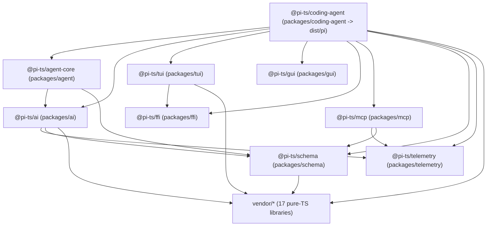

# Architecture

`pi-ts` compiles the Pi `v1.5.2` TypeScript monorepo directly to a single native executable (`dist/pi`) using `scriptc --node-islands=off`, eliminating Node.js runtime islands (`SCRIPTC_LIBNODE=/nonexistent`), third-party `node_modules` installs, and `.node` native addons.

## Workspace Dependency Graph

Workspace packages resolve directly to TypeScript source files via `paths` in [`tsconfig.json`](../tsconfig.json) for `scriptc` AOT builds and [`vitest.base.ts`](../vitest.base.ts) for Vitest.

## Native AOT Execution Model (`--node-islands=off`)

- **Single binary (`dist/pi`)**: Compiled from [`packages/coding-agent/src/cli.ts`](../packages/coding-agent/src/cli.ts), serving interactive TUI, 3-pane Waku desktop GUI (`--gui` / `--mode gui`), non-interactive print (`-p`), JSON event stream (`--mode json`), and JSONL RPC (`--mode rpc`) from one executable.
- **Zero Node islands**: Pure-TypeScript HTTP/SSE/EventStream stacks in [`packages/ai/src/api/`](../packages/ai/src/api/) (`anthropic-http.ts`, `openai-http.ts`, `bedrock-eventstream.ts`, `google-wire-types.ts`, plus enterprise AWS Bedrock / Google Vertex AI credential resolution) replace heavy external Node SDK packages so `dist/pi` and `dist/test-native` run with `SCRIPTC_LIBNODE=/nonexistent`.
- **Static compilation constraints**: Reachable TypeScript modules avoid `Proxy`/`Reflect`, Node `vm`, and TS default exports/imports (`SC1012` — named exports only, except static JSON `with { type: "json" }` imports).

## `@pi-ts/ffi` Native Darwin Bindings

[`packages/ffi/`](../packages/ffi/) provides static Darwin FFI primitives compiled into `packages/ffi/native/darwin/build/libpiffi.a` from [`packages/ffi/native/darwin/src/pi_ffi_darwin.m`](../packages/ffi/native/darwin/src/pi_ffi_darwin.m) and declared in [`packages/ffi/ffi/darwin.json`](../packages/ffi/ffi/darwin.json) and [`packages/ffi/ffi/darwin-gui.json`](../packages/ffi/ffi/darwin-gui.json):

| Capability | C Symbols (`libpiffi.a`) | TypeScript Entrypoint |
|---|---|---|
| Availability & scratch transfer | `pi_ffi_available`, `pi_ffi_read_scratch` | `isNativeDarwinAvailable` |
| Pasteboard text, PNG, and file URLs | `pi_ffi_clipboard_get_text`, `pi_ffi_clipboard_set_text`, `pi_ffi_clipboard_get_image_png`, `pi_ffi_clipboard_get_file_paths` | `nativeClipboardGetText`, `nativeClipboardSetText`, `nativeClipboardGetImagePng`, `nativeClipboardGetFilePaths` |
| Live keyboard modifier state | `pi_ffi_is_modifier_pressed` | `nativeIsModifierPressed` |
| ImageIO inspection and resizing | `pi_ffi_image_inspect`, `pi_ffi_image_transform` | `nativeImageInspect`, `nativeImageTransform` |
| CoreFoundation word segmentation | `pi_ffi_word_segment` | `nativeWordSegment` |
| Isolated JavaScriptCore VMs | `pi_ffi_jsc_create`, `pi_ffi_jsc_eval`, `pi_ffi_jsc_destroy` | `nativeJscCreate`, `nativeJscEval`, `nativeJscDestroy` |

On macOS, [`build.sh`](../build.sh) links `packages/ffi/ffi/darwin-gui.json`, combining `libsgui.a` and `libpiffi.a` with AppKit, CoreFoundation, CoreGraphics, CoreText, Foundation, ImageIO, JavaScriptCore, and QuartzCore frameworks.

## Vendored Libraries (`vendor/`)

17 runtime dependencies are vendored directly as pure TypeScript under [`vendor/`](../vendor/) and mapped in [`tsconfig.json`](../tsconfig.json):

| Directory | Package Role |
|---|---|
| `vendor/brace-expansion/` | Brace pattern expansion (used by `minimatch`) |
| `vendor/chalk/` | ANSI terminal styling |
| `vendor/cross-spawn/` | Cross-platform process spawning |
| `vendor/diff/` | Line, word, JSON, array, and patch diffs |
| `vendor/get-east-asian-width/` | East Asian character width tables |
| `vendor/highlight-js/` | Syntax highlighting across 67 languages and fence aliases |
| `vendor/hosted-git-info/` | Git hosting URL parser |
| `vendor/ignore/` | `.gitignore` pattern matching |
| `vendor/lovely-mermaid/` | Terminal and layout Mermaid diagram renderer |
| `vendor/marked/` | Markdown lexer and parser |
| `vendor/marked-cjk-friendly/` | CJK emphasis/punctuation extension for `marked` |
| `vendor/minimatch/` | Glob matching |
| `vendor/partial-json/` | Streaming partial JSON parser for tool arguments |
| `vendor/proper-lockfile/` | Advisory filesystem lockfiles |
| `vendor/semver/` | Semantic version parsing, ranges, and comparisons |
| `vendor/typebox/` | TypeBox schema builders compiled with `@pi-ts/schema` |
| `vendor/yaml/` | YAML 1.2 parser and serializer |

## Storage & Wire Compatibility

- **Agent directory (`~/.pi/agent` or `$PI_CODING_AGENT_DIR`)**: Stores `settings.json`, `auth.json`, `models.json`, session `.jsonl` files, lockfiles, skills, prompt templates, themes, and extensions in the standard Pi `v1.5.2` format.
- **Automation protocols**: `pi --mode json` and `pi --mode rpc` emit and consume Pi's JSONL event and command protocol.
